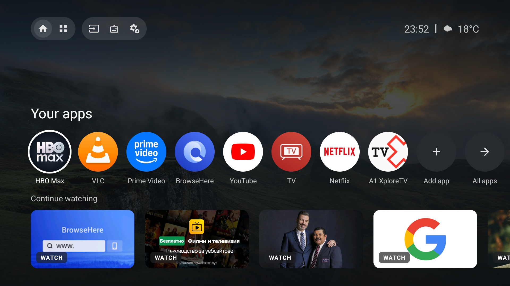

# TCL GTV Launcher

[](https://github.com/matasarei/tcl-gtv-launcher/actions/workflows/ci.yml)
[](LICENSE)
[](https://android.com/tv/)
[](#tested-devices)
[](#network--privacy)

A clean, ad-free, high-performance Google TV–style home screen purpose-built for TCL Google TVs and Android TVs.

This is a dedicated fork of [alexkev/tcl-gtv-launcher](https://github.com/alexkev/tcl-gtv-launcher), deeply enhanced for TCL hardware integration. It replaces Google TV's ad-heavy, slow launcher with an ultra-responsive interface, native OEM remote button mapping, a customizable top menu with a native TCL source input selector, quick settings overlays, and safe automated debloating.

<a id="tested-devices"></a>
**Tested on:**
- TCL 43V6B (Realtek RTD2851, Android 11 TV API 30, build GTV93)
- TCL Smart TV Pro / G08_4K_GB (Mediatek MT5896, Android 14 TV API 34)
- TCL G03_4K_US (Android 11, build GTV93)
- TCL Smart TV (Android 12, build AS50)



---

## Highlights of this Fork

- **Native TCL Remote Button Mapping (`GlobalKeyService`):**
  - **Settings key (`4077` / `4017` / `176`):** opens the fast Quick Settings overlay globally across any app.
  - **Profile / People switch key (`4016` / `288` / `303`):** opens Quick Settings focused directly on the Accounts tile (press again to dismiss).
  - **TV key (`4001` / `170` / `172`):** launches native Live TV broadcast directly (`com.tcl.tv`).
  - **LIST key (`4018` / `257`):** context-aware — delivers hardware key to TCL TV for native channel lists when watching TV, or launches Live TV when outside.
- **Modern Top Bar Navigation:**
  - Dedicated **TV Inputs selector** button (`ic_input`) triggering TCL's native source overlay (`ShowWindowService`) with system fallback.
  - Plain icon top actions: Inputs, Settings, Screensaver, Live TV (auto-hidden when antenna channels are unconfigured), Clock and Weather.
- **Quick Settings Overlay:**
  - Accessible without leaving your current video or app: Wi-Fi, Bluetooth, Inputs, Display & Sound, System Settings, Accounts & Profiles, App Manager, and Sleep.
- **Performance & Memory Tuning:**
  - Memory-optimized bitmap decoding (`RGB_565`) designed for budget TV SoCs with 1.5GB–2GB RAM.
  - Efficient event-driven window tracking without synchronous IPC bottlenecks or keylogging.
- **Modular & Configurable Setup:**
  - Opt-in flags for bundled wallpaper pack (`WALLPAPERS=1`), AdGuard Private DNS (`ADGUARD_DNS=1`), and Plezy Plex client (`PLEZY=1`).
  - Bundled local wallpaper rotation or live Google Photos album stream.

---

## Features

- **Top bar:** Home / Live (auto-detects channel presence) / Apps tabs, Inputs switcher, Google screensaver trigger, Quick Settings, Time and Weather.
- **Backgrounds:** Bundled local wallpaper collection (with dynamic rotation) or photos from a Google Photos shared album.
- **Your apps:** Reorderable circular app icons (hold OK on any app, or use Reorder).
- **Continue watching:** Integrates with Android TV's Watch Next API (Netflix, HBO Max, Disney+, Paramount+, etc.) plus dedicated YouTube rows.
- **Plex integration:** Stream media from your Plex server directly via [Plezy](https://github.com/edde746/plezy) or standard intent links.
- **Apps grid:** Full grid of installed apps; long press OK to uninstall.
- **Multilingual:** Full localization support for all 24 official EU languages plus Ukrainian and Russian, automatically adapting to the TV's system language.
- **Safe debloat:** Automated disable list in `kit/debloat.txt` that shuts off TCL telemetry, ad banners, and background bloatware without breaking system functionality.

---

## Before You Start

### On your computer (Mac or Linux / PC):
- Git, Python 3, `curl`, `adb` (from Android SDK platform-tools)
- JDK 17 and Android SDK (platform 34). Set `ANDROID_HOME` or specify `sdk.dir=...` in `launcher/local.properties`.

```bash
git clone --recurse-submodules https://github.com/matasarei/tcl-gtv-launcher.git
cd tcl-gtv-launcher
```

### On the TCL TV:
1. **Settings > System > About:** click OK on **Android TV OS build** 7 times to enable Developer Options.
2. **Settings > System > Developer options:** turn on **USB debugging** (and **Network debugging** if present).
3. Check the TV's IP address (**Settings > Network & Internet**).

---

## Installation

Run the setup script from the repository root:

```bash
# Minimal clean setup (clean dark background, system DNS)
kit/setup.sh <tv-ip>

# Setup with bundled wallpapers
WALLPAPERS=1 kit/setup.sh <tv-ip>

# Setup with bundled wallpapers, AdGuard ad-blocking DNS, and Plezy
WALLPAPERS=1 ADGUARD_DNS=1 PLEZY=1 kit/setup.sh <tv-ip>

# Setup with Google Photos album background
kit/setup.sh <tv-ip> "https://photos.app.goo.gl/your-album-link"
```

Accept the **"Allow USB debugging"** prompt on the TV screen when it appears.

### What `kit/setup.sh` does:
1. **Backs up** the TV's stock state (installed packages, disabled packages, and system settings) into `backup/<tv-ip>/`.
2. **Debloats** telemetry, tracking, and ad packages in `kit/debloat.txt` safely using [cleanyourtv](https://github.com/Gathin23/cleanyourtv).
3. **Applies optional configurations** (AdGuard Private DNS, bundled wallpaper assets, Plezy).
4. **Builds and installs** the launcher APK and grants required accessibility permissions (`GlobalKeyService`).
5. **Sets the launcher as default Home** and disables Google TV's stock launcher (`com.google.android.apps.tv.launcherx`).
6. **Reboots the TV** to guarantee clean state.

---

## After Setup

- **Remote buttons:** Verify that Home, Settings, Profile, TV, and LIST keys trigger their corresponding functions.
- **Your apps:** Add your favorite apps with `+`; hold OK on any icon to reorder or remove it.
- **Weather:** Automatically resolved via IP geolocation, with temperature units (°C or °F) automatically chosen based on location/locale (customizable via `temperature_unit` and `weather_city` in `launcher/app/src/main/res/values/config.xml`).
- **Security:** Once set up, disable USB / Network debugging in Developer Options and revoke debugging authorizations. Verify with:
  ```bash
  cleanyourtv/tools/venv/bin/python cleanyourtv/tools/adb-closed.py <tv-ip>
  ```

---

## Reverting / Undo

Everything disabled can be restored at any time:

```bash
# Restore Google TV's original home launcher
TV_HOST=<tv-ip> cleanyourtv/tools/restore.sh kit/home.txt

# Restore all debloated system apps
TV_HOST=<tv-ip> cleanyourtv/tools/restore.sh kit/debloat.txt

# Restore default DNS
TV_HOST=<tv-ip> cleanyourtv/tools/venv/bin/python cleanyourtv/tools/tv.py "settings put global private_dns_mode opportunistic"
```

---

<a id="network--privacy"></a>
## Network & Privacy

The launcher contains **no tracking, no ads, and no analytics**. Network access is strictly limited to:
- **Weather:** Open-Meteo API and `ipapi.co` (skipped if `weather_city` is explicitly configured).
- **Background:** Your Google Photos album URL (only when an album link is provided).
- **Plex:** Direct communication with `plex.tv` and your local Plex Media Server.
- **Posters:** Thumbnail artwork provided locally by Android TV's Watch Next provider apps.

---

## License

MIT License. See [LICENSE](LICENSE) for details.

- Upstream project: [alexkev/tcl-gtv-launcher](https://github.com/alexkev/tcl-gtv-launcher)
- Debloating tools adapted from [cleanyourtv](https://github.com/Gathin23/cleanyourtv) (MIT, copyright Gathin).
- [Plezy](https://github.com/edde746/plezy) is downloaded directly from its official releases when requested and is not bundled in this repo.
